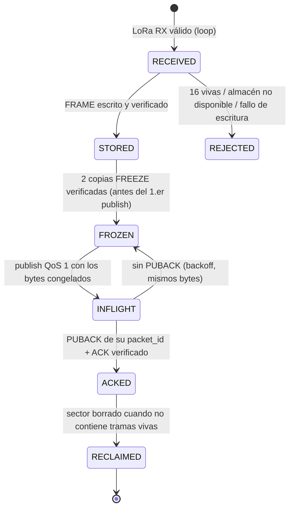

# MQTT-QUEUE-PERSISTENCE-05 — Persistencia durable de la cola del Gateway

Estado: **implementado, NO compilado, NO probado, NO validado en hardware.**
Toda afirmación de este documento describe el código; ninguna es un resultado
de prueba.

## 1. Arquitectura

| Módulo | Responsabilidad |
|---|---|
| `gateway/GatewayFrameLog.h/.cpp` | Núcleo puro (sin Arduino/FreeRTOS/ESP-IDF): formato, serialización explícita, CRC32, recuperación, anexado, FREEZE/ACK, gestión de sectores. Accede a la flash solo mediante `FlashRegion`. No es thread-safe. |
| `gateway/GatewayFrameStore.h/.cpp` | Adaptador ESP32: localiza y valida la partición, implementa `FlashRegion` con `esp_partition_*`, mutex FreeRTOS único, contadores y estado de diagnóstico, región RAM explícita para builds de diagnóstico. |
| `gateway/gateway.ino` | `enqueueFrame()` (loop) guarda; `mqttTask()` hace `maintain()`, lee la cabeza, congela, publica y confirma. |
| `gateway/GatewayConfig.h` | Etiqueta/tamaño esperados de la partición y espera máxima del mutex. |

El almacén es la **única fuente de verdad**: la cola FreeRTOS y la ranura
`pending` en RAM se eliminaron. La réplica RAM (`live_`) se reconstruye desde
flash en cada arranque.

### Propiedad de las operaciones

| Operación | Quién | Flash |
|---|---|---|
| FRAME (aceptar trama) | `loop()` vía `enqueueFrame()` | programa 192 B, nunca borra |
| FREEZE ×2, ACK | `mqttTask()` | programa 32 B cada uno |
| Preparar sector, reclamar sector, completar borrados pendientes, FREEZE de tramas recuperadas | `mqttTask()` vía `maintain()` | programa y **borra** |
| Lectura de la cabeza | `mqttTask()` (`peekHead`, copia) | — |

Todas las funciones del adaptador toman y sueltan el mutex internamente; ningún
llamador lo mantiene durante `ensureMqtt()`, `mqtt.loop()` ni `publish()`. No
hay bloqueos anidados.

## 2. Ciclo de vida de una trama

- **Inserción:** capacidad (16) → mutex → serialización → FRAME → relectura y
  comparación → solo entonces entra en la réplica RAM. Si falla, la trama se
  rechaza; además se intenta un registro `CANCEL` para que un FRAME
  posiblemente legible no reaparezca tras un reinicio.
- **Congelación:** se decide `buffered` una vez, con la misma semántica que
  antes (sin enlace al recibir, otras tramas esperando, ≥ 1 s de espera) y
  `true` para tramas recuperadas sin FREEZE. Se escriben y verifican **dos**
  registros FREEZE independientes; sin ambos no se publica.
- **Publicación:** sin cambios (`publishFrozenPayload`, QoS 1, mismo tópico,
  Client ID, credenciales y backoff). El payload se reconstruye siempre a
  partir de los campos guardados y del `buffered` guardado, por lo que es
  byte-idéntico en cada reintento, también tras un reinicio.
- **Confirmación:** tras el PUBACK se escribe y verifica ACK; solo entonces la
  trama sale de la réplica. Si ACK falla, la trama sigue viva y se reintenta
  únicamente el ACK (sin republicar); tras un reinicio se republica.

## 3. Formato en flash (versión 1, little-endian)

Región: partición existente `spiffs` (data/spiffs, 0x160000 B = 352 sectores de
4096 B). No se modifica la tabla de particiones.

### Cabecera de sector (32 B)

| Offset | Campo |
|---|---|
| 0 | magic `AGQ1` (0x31514741) |
| 4 | `format_version` u16 = 1 |
| 6 | `header_size` u16 = 32 |
| 8 | `sector_seq` u32 (monótono, nunca reutilizado) |
| 12 | `region_uid` u32 (aleatorio, fijado al inicializar) |
| 16 | `region_sectors` u32 (352) |
| 20 | `frame_seq_floor` u32 (siguiente seq de trama al preparar el sector) |
| 24 | reservado u32 = 0 |
| 28 | CRC32 de los bytes 0..27 |

### Registros

Todos comienzan en offsets múltiplos de 16, tienen longitud fija por tipo
(múltiplo de 16) y terminan con CRC32 de todos los bytes anteriores del
registro. Cabecera común (16 B): `'A' 'R'`, `type`, `record_version`=1,
`length` u16, reservado u16=0, `seq` u32, `region_uid` u32.

| Tipo | Long. | Cuerpo |
|---|---|---|
| 1 FRAME | 192 | `frame_length` u16, `rssi` i16, `snr` (bits IEEE-754) u32, `rx_time` i64, flags u8 (bit0 `time_synced_at_rx`), 3 B reservados, `bytes[137]`, relleno a cero |
| 2 FREEZE | 32 | `buffered` u32 (0/1), `copy` u32 (0/1), reservado |
| 3 ACK | 32 | reservado (seq = trama confirmada) |
| 4 CANCEL | 32 | reservado (seq = trama rechazada) |
| 5 INIT | 32 | `format_version`, `region_sectors` (marca de inicialización) |
| 6 PREPARE | 32 | sector destino, `sector_seq` que recibirá |
| 7 RECLAIM | 32 | sector destino, su `sector_seq` |

Serialización campo a campo (`put16/put32/put64`); no se copia ninguna
estructura C++ a flash. CRC-32/ISO-HDLC implementado en el núcleo (sin
dependencias).

Un registro solo se acepta si pasan **todas** las comprobaciones: magic,
versión, tipo conocido, longitud exacta del tipo, cabe en el sector,
`region_uid`, CRC32, campos reservados a cero, rangos válidos y, para FRAME,
`seq` estrictamente creciente.

## 4. Recuperación al arrancar (`FrameLog::open`, solo lectura)

1. Partición: etiqueta, tipo, subtipo, tamaño exacto, `erase_size` = 4096, no
   cifrada, no de solo lectura. Si no cumple → **no disponible**.
2. Lectura de las 352 cabeceras: vacía, válida, sucia (programada sin cabecera
   válida). Una cabecera `AGQ1` con CRC correcto pero otra versión, geometría
   o `region_uid` → **incompatible** (no se toca nada).
3. Sin cabeceras válidas: si no hay sectores sucios y **toda** la región está
   en 0xFF → inicialización (sección 6). Si no → **datos desconocidos** (no se
   toca nada).
4. Sectores válidos ordenados por `sector_seq` (duplicados → incompatible).
5. Reproducción de registros en orden: FRAME añade, FREEZE fija/cuenta copias
   (copias con valores distintos → `freeze_unknown`), ACK/CANCEL eliminan,
   RECLAIM elimina las tramas del sector reclamado y PREPARE/RECLAIM anotan
   intenciones.
6. Sectores sucios con intención PREPARE/RECLAIM → borrado pendiente
   (demostradamente propios); sin intención → **cuarentena** (nunca se borran).
   Sectores válidos con RECLAIM registrado → borrado pendiente.
7. Cola: el sector válido más nuevo. Si su final no está limpio, se marca
   cerrado y se continúa en un sector preparado por `mqttTask`.
8. Tramas vivas en orden FIFO (seq). Si son más de 16 → **no disponible**
   (`OverCapacity`), sin borrar nada.
9. Siguiente seq = máx(seq vistos + 1, `frame_seq_floor` de las cabeceras); el
   siguiente `sector_seq` también se deriva del máximo visto: ningún
   identificador se reutiliza aunque se hayan reclamado los sectores.

El arranque normal **no escribe** en flash. Las escrituras necesarias
(preparar sector, completar borrados, FREEZE de tramas recuperadas) las hace
después `mqttTask`.

### Registros corruptos

- Un área inválida se cuenta, cierra el sector para anexados y se busca el
  siguiente registro **solo** en posiciones alineadas a 16 B que superen la
  validación completa. Si no aparece ninguno, se abandona el resto del sector.
- Si después del área dañada no hay ningún registro válido en ese sector, es
  la firma de una escritura interrumpida: ese registro nunca se verificó y
  nada se publicó apoyándose en él.
- Si después hay registros válidos en el mismo sector, el área ya estaba
  escrita y verificada: las tramas anteriores a ella que no tengan FREEZE
  válido quedan `freeze_unknown`.
- FRAME corrupto: la trama se pierde (riesgo documentado). ACK corrupto: la
  trama se reenvía con los mismos bytes y el backend la deduplica. FREEZE: si
  queda una copia válida se usa; si no puede saberse, la trama **no se
  publica** y la cola queda retenida con un log periódico (decisión de
  operador).

## 5. Gestión de sectores

- Siempre se mantiene un sector **preparado** por delante (cabecera escrita y
  verificada) para que `loop()` nunca necesite borrar.
- Preparar: comprobar que el sector está completamente en 0xFF → registrar
  PREPARE → escribir y verificar cabecera. Los registros ordinarios dejan
  siempre 32 B libres en el sector de cola para que PREPARE quepa.
- Reclamar: solo el sector **más antiguo**, que no sea cola ni preparado y sin
  tramas vivas (FIFO), y solo si no hay otro borrado pendiente → registrar
  RECLAIM → borrar → verificar 0xFF.
- Un borrado que falla 3 veces pone el sector en cuarentena.
- Selección circular desde la cola en adelante, para repartir el desgaste en
  los 352 sectores.

## 6. Primer uso

Solo si **todos** los bytes de la partición están en 0xFF: se escribe la
cabecera del sector 0 (seq 1) y el registro INIT, ambos verificados. Cualquier
dato desconocido, versión incompatible o estructura parcial impide la
inicialización: no se formatea, borra ni sobrescribe nada.

Consecuencia: si una placa ya tiene datos en `spiffs` (por ejemplo, un SPIFFS
anterior), el almacén queda **no disponible** hasta que un operador decida
borrar la partición de forma explícita (fuera del firmware). Lo mismo ocurre
si se corta la alimentación durante la propia inicialización.

## 7. Errores y estado seguro

| Situación | Comportamiento |
|---|---|
| Partición ausente o inválida, datos desconocidos, incompatible, sobrecapacidad, E/S | `[STORE] UNAVAILABLE: <motivo>`; ninguna trama se acepta ni publica; LED en patrón de error; MQTT sigue conectado sin publicar; nada se borra |
| Fallo de escritura o verificación de FRAME | trama rechazada (no entra en RAM ni se publica); CANCEL si es posible; contador; LED de error hasta el siguiente guardado correcto; el almacén no se reinicializa |
| 16 tramas vivas | rechazo de la nueva sin escribir; las guardadas intactas |
| Mutex no disponible en `GATEWAY_FRAME_STORE_LOCK_TIMEOUT_MS` | la trama se rechaza (no se espera indefinidamente en `loop()`) |
| FREEZE desconocido en la cabeza | no se publica; log cada 30 s; cola retenida |

### Builds de diagnóstico

Mecanismo real: `GATEWAY_MQTT_DIAG_ENABLED` → `gateway_diag::kEnabled`
(`GatewayDiagnostics.h`); los `static_assert` existentes impiden combinarlo con
producción. En ese caso `begin(true)` usa una región **RAM** explícita de
4 sectores (16 KB de heap), lo anuncia en el arranque y **no localiza, lee ni
escribe** la partición. Las tramas inyectadas con `DIAG PUBLISH` se pierden al
reiniciar, por diseño.

## 8. Contadores (`DIAG STATUS` y logs `[STORE]`)

Adaptador: `accepted`, `rejected_full`, `rejected_unavailable`,
`rejected_write`, `lock_timeouts`, `freeze_failures`, `ack_failures`.
Núcleo: `corrupt_records`, `closed_sectors`, `quarantined_sectors`,
`write_failures`, `verify_failures`, `erase_failures`, `reclaimed_sectors`,
`prepared_sectors`, `unlogged_prepares`, `cancel_failures`,
`freeze_conflicts`, `freeze_unknown`.

## 9. Desgaste de flash (estimación)

Datos comprobados: 352 sectores de 4096 B (tabla por defecto del core 3.3.12).
**Datos que faltan:** resistencia a ciclos de borrado y tiempos de
programación/borrado del chip real (hoja de datos del módulo montado).

| Operación | Bytes programados | Borrados |
|---|---|---|
| FRAME | 192 | — |
| FREEZE | 2 × 32 | — |
| ACK | 32 | — |
| Por trama | 288 (+ relectura de verificación) | ~1/14 de sector |
| Por sector (ciclo) | cabecera 32 + PREPARE 32 + RECLAIM 32 | 1 |
| Arranque normal | 0 | 0 |
| Recuperación con tramas sin FREEZE | 64 por trama | 0 |

Unas 14 tramas por sector, por lo que hay un borrado cada ~14 tramas,
repartido entre 352 sectores (cada sector se borra una vez cada ~4.900 tramas).

| Tramas/día (hipótesis: 1, 5 y 20 Coordinators a 60 s) | Borrados por sector y día |
|---|---|
| 1.440 | ≈ 0,29 |
| 7.200 | ≈ 1,46 |
| 28.800 | ≈ 5,8 |

Vida útil estimada = resistencia del chip / borrados por sector y día. **No se
declara una vida útil:** el valor de resistencia (a menudo citado como 100.000
ciclos) es una hipótesis hasta leer la hoja de datos del chip real.

## 10. Efecto sobre LoRa y los núcleos

- `loop()` ahora vuelve a poner el SX1278 en recepción **antes** de escribir
  el FRAME (cambio mínimo de orden en `loop()`), para que el siguiente paquete
  pueda entrar en el FIFO de la radio durante la escritura.
- Aun así, la escritura (programar 192 B y releerlos) ocupa `loop()`, y
  `loop()` puede esperar el mutex mientras `mqttTask` borra un sector (hasta
  `GATEWAY_FRAME_STORE_LOCK_TIMEOUT_MS`).
- Durante las operaciones de flash, ESP-IDF deshabilita la caché y detiene
  ambos núcleos (inferencia del funcionamiento documentado de ESP-IDF, no
  medido aquí).
- **No se afirma que la recepción LoRa esté protegida:** si llegan dos paquetes
  durante una de estas ventanas, el FIFO de la radio puede perder uno. La
  duración real depende de tiempos de flash no medidos.

## 11. Riesgos y limitaciones

- Código no compilado ni probado; las pruebas de host con inyección de cortes
  todavía no existen.
- Atomicidad: la detección de escrituras interrumpidas depende del CRC32
  (probabilidad de falso positivo ≈ 2⁻³²) y de la validación estricta.
- Una trama `freeze_unknown` en cabeza retiene la cola hasta que un operador
  intervenga (no hay comando de liberación en esta fase).
- Una trama que el broker no acepte nunca (p. ej. ACL) retiene la cola.
- Cuarentena: cada borrado interrumpido sin intención registrada o cada
  sector defectuoso reduce la capacidad de rotación (contado).
- Un sector en cuarentena que conserve registros válidos de tramas ya
  confirmadas podría, tras reclamarse el sector con su RECLAIM, reaparecer en
  una recuperación posterior y generar reenvíos deduplicados.
- Partición cifrada no soportada (los bytes borrados no se leen como 0xFF).
- Cambiar el esquema de particiones del IDE o usar SPIFFS/LittleFS en
  `spiffs` entra en conflicto con este almacén.
- RAM: unos 12 KB estáticos estimados (réplica de 24 entradas y metadatos de
  384 sectores; el tamaño exacto depende del relleno del compilador), frente a
  ~2,7 KB de heap de la cola anterior. Está pendiente de medir al compilar.

## 12. Validaciones pendientes para el cierre

1. Compilación con `esp32:esp32:esp32` (producción, MQTT activo y diagnóstico).
2. Pruebas de host del núcleo con flash simulada: codificación, recuperación,
   resincronización, primer uso, datos ajenos, sobrecapacidad y corte de
   energía en cada byte y operación.
3. Revisión estática independiente.
4. Validación física: cortes en cada estado, identidad de bytes (SHA-256 de
   diagnóstico) y `REDELIVERY` en Django, cola llena, partición con datos
   ajenos y medición de tiempos de flash y su efecto en LoRa.
